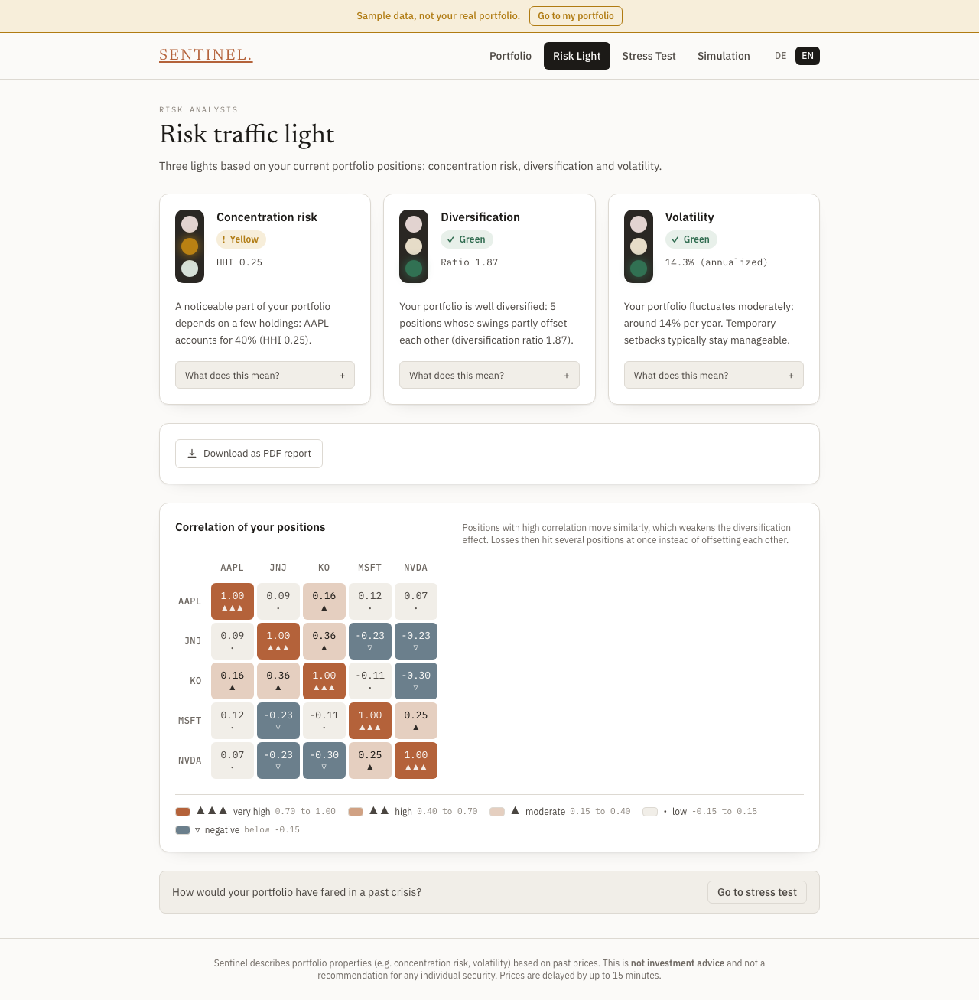
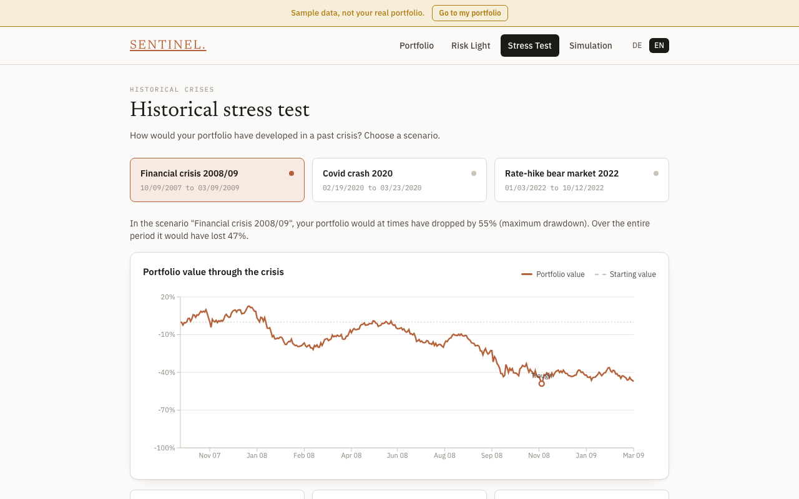
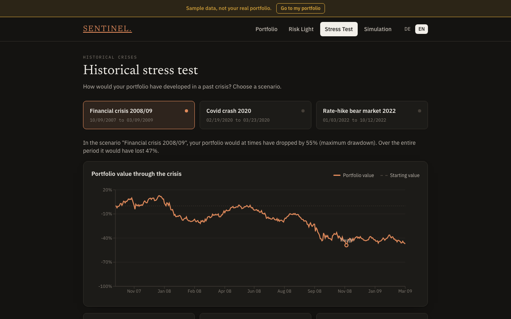
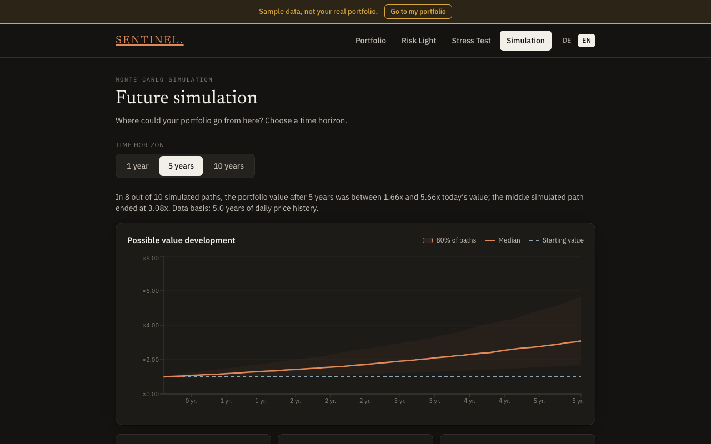

# Sentinel

**Portfolio-Risiko verstehen, nicht nur berechnen.**

🔗 **Live-Demo: [sentinel-intelligence-rust.vercel.app](https://sentinel-intelligence-rust.vercel.app)**
(Der Backend-Kaltstart kann beim ersten Aufruf bis zu einer Minute dauern, s.
[Bekannte Einschränkungen](#bekannte-einschränkungen).)

> **Status: Feature-complete, nicht in aktiver Entwicklung.** Das Projekt ist
> eingefroren: alle Abhängigkeiten sind exakt gepinnt, die Demo läuft ohne
> Pflege weiter. Neustart und Übergabe: [`HANDOVER.md`](./HANDOVER.md).

Sentinel ist ein Lern-Tool für Einsteiger:innen, die Portfoliorisiko wirklich
verstehen wollen, statt nur eine Kennzahl zu sehen. Mit virtuellem Spielgeld
ein Depot aufbauen, zu echten (verzögerten) Kursen handeln, und dabei in
verständlicher Sprache erklärt bekommen, wo die eigenen Risiken liegen.

> ⚠️ Sentinel ist ein Lern- und Übungstool. Nichts in der App ist eine
> Anlageberatung oder Kaufempfehlung für konkrete Wertpapiere.

---

## Live Demo

Das Backend läuft auf einem kostenlosen Render-Tier und schläft nach
Inaktivität ein. Beim ersten Aufruf nach einer Weile kann deshalb ein
Kaltstart von 30–60 Sekunden auftreten, bevor die App reagiert – kein
Bug, einfach der Free-Tier. Danach läuft alles normal schnell.

---

## Screenshots

Englische Demo (`?demo=1`, Beispieldepot), Light und Dark.

| Risk traffic light (light) | Historical stress test (light) |
|---|---|
|  |  |

| Stress test (dark) | Simulation (dark) |
|---|---|
|  |  |

Alle Screenshots (inkl. Depot) und das Erzeugungs-Script:
[`docs/screenshots/`](./docs/screenshots/).

---

## Was Sentinel kann

- 📈 **Paper-Trading** – Depot mit virtuellem Startkapital, Trades zu echten
  Marktkursen, vollständige Positions- und P&L-Historie
- 🚦 **Erklärbare Risiko-Ampel** – Klumpenrisiko, Diversifikation und
  Volatilität verständlich erklärt statt als Black-Box-Zahl
- 📉 **Historischer Stress-Test** – wie hätte sich dein aktuelles Depot in
  der Finanzkrise 2008, dem Corona-Crash 2020 oder der Zinswende 2022
  entwickelt?
- 🎲 **Monte-Carlo-Zukunftssimulation** – Bandbreite plausibler
  Wertentwicklungen über 1/5/10 Jahre, auf Basis echter historischer
  Tagesrenditen
- 🧮 **Unabhängige Portfolio-Analyse** – Ticker manuell eingeben oder CSV
  hochladen, Risiko-Score samt Treibern berechnen
- ⚖️ **Portfolio-Optimierung** – Max-Sharpe-Gewichtsvorschlag (Long-only,
  mit Positionsobergrenze)
- 🤖 **Optionale KI-Markteinschätzung** – Sentiment-gestützte Anpassung,
  standardmäßig deaktiviert (siehe [KI-Funktion](#ki-funktion))

## Tech-Stack

| Bereich | Technologie |
|---|---|
| Backend | Python, FastAPI, Pydantic, NumPy/SciPy/pandas |
| Frontend | Next.js, TypeScript, TanStack Query, Recharts, Tailwind |
| Daten | yfinance (Marktdaten), Google News RSS (optional, KI-Kontext) |
| Tests | pytest (Backend, 400+ Tests), vitest, Playwright-E2E (DE/EN, Light/Dark), TypeScript strict mode |

## Architektur

Das Projekt ist als sauber getrenntes Monorepo aufgebaut:

```
sentinel/
├── backend/
│   ├── src/sentinel_core/     # Fachlogik – UI-/HTTP-frei, vollständig getestet
│   └── src/sentinel_api/      # FastAPI-Schicht – reines Verdrahten, keine Fachlogik
└── frontend/                  # Next.js App Router, TypeScript
```

Ausführliche Dokumentation der Design-Entscheidungen:

- [`ARCHITECTURE.md`](./ARCHITECTURE.md) – Gesamtarchitektur, Datenmodell, API-Grenzen
- [`API_CONTRACT.md`](./API_CONTRACT.md) – vollständiger Endpunkt- und Fehlerformat-Vertrag
- [`FRONTEND_DECISIONS.md`](./FRONTEND_DECISIONS.md) – State-Management, Routing, Charting
- [`STRESS_TEST_DECISIONS.md`](./STRESS_TEST_DECISIONS.md) / [`MONTE_CARLO_DECISIONS.md`](./MONTE_CARLO_DECISIONS.md) – Feature-spezifische Entscheidungen

Jede fachliche Regel (Risikoformeln, Fallback-Verhalten, Edge Cases) ist mit
Begründung dokumentiert, nicht nur implementiert – Ziel ist Nachvollziehbarkeit,
nicht nur Funktionalität.

## Lokal starten

**Backend:**
```bash
cd backend
pip install -r requirements-dev.txt   # exakt gepinnter Dependency-Baum
PYTHONPATH=src uvicorn sentinel_api.main:app --reload
```

**Frontend:**
```bash
cd frontend
npm install
npm run dev
```

Frontend läuft dann auf `http://localhost:3000`, Backend auf
`http://localhost:8000`.

Für den lokalen Betrieb sind keine Umgebungsvariablen nötig: `ALLOWED_ORIGINS`,
`TRUSTED_HOSTS` (Backend) und `NEXT_PUBLIC_API_URL` (Frontend) haben sinnvolle
Defaults für genau dieses Setup (`localhost:3000` / `*` / `http://localhost:8000`)
und werden nur für den Live-Deploy explizit gesetzt – siehe
`backend/.env.example` und `frontend/.env.local.example`.

## Tests

```bash
# Backend
cd backend && pytest && ruff check . && black --check .

# Frontend
cd frontend && npm run build && npm test && npm run test:e2e
```

## KI-Funktion

Die optionale KI-Markteinschätzung nutzt Claude (Anthropic API) für eine
Sentiment-gestützte Risikoanpassung. Sie ist **standardmäßig deaktiviert**
(`SENTINEL_AI_ENABLED=false`), damit in diesem öffentlichen Repository keine
unbeabsichtigten API-Kosten entstehen. Zum Aktivieren:

```bash
SENTINEL_AI_ENABLED=true
ANTHROPIC_API_KEY=dein-key
```

Ohne aktivierten Key liefert die App durchgehend ein neutrales Ergebnis –
kein Feature funktioniert eingeschränkt oder bricht.

## Projektstatus

Solo-Side-Project neben dem Wirtschaftsinformatik-Studium. Das Projekt ist
[live deployed und nutzbar](#live-demo) – Backend und Frontend sind
funktional vollständig (Kern-Loop Depot → Ampel → Stress-Test → Simulation
sowie unabhängige Analyse/Optimierung).

Das Projekt ist **eingefroren** (Details, offene Punkte und Neustart-Anleitung
in [`HANDOVER.md`](./HANDOVER.md)). Das Backend hat ein großzügiges
Pro-IP-Rate-Limit (Default 120 Anfragen/Minute).

## Bekannte Einschränkungen

- **yfinance ist inoffiziell.** Die Kursdaten kommen über eine nicht
  offizielle Yahoo-Finance-Schnittstelle ohne Verfügbarkeitsgarantie. Yahoo
  kann sie jederzeit ändern oder sperren. Dann liefern die Endpunkte einen
  freundlichen Fehler (`UPSTREAM_UNAVAILABLE`), Rechnen mit Kursdaten geht
  nicht mehr, bis die Datenquelle ersetzt ist.
- **Cold-Start auf dem Free-Tier.** Das Backend schläft nach Inaktivität ein;
  der erste Aufruf braucht 30–60 Sekunden. Die App zeigt nach ca. 8 Sekunden
  einen Hinweis dazu.
- Keine Anlageberatung, Kurse sind verzögert (ca. 15 Minuten).

## Lizenz

MIT - siehe [LICENSE](./LICENSE).
